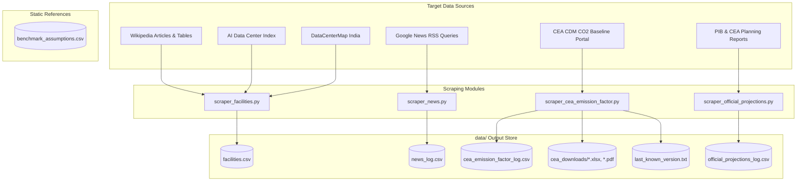

# India Data Center Demand-Side Web Scraping Suite

This repository houses the Python-based data collection pipeline for the **Demand-Side** component of a dissertation on **AI Data Center Energy Demand in India**.

Because no single authoritative database contains complete facility, workload, project pipeline, and grid emission data for India's rapidly expanding data center sector, this suite deploys four specialized, decoupled scrapers alongside a curated benchmark assumptions registry.

---

## 🏗️ Architecture & Component Overview



---

## 📋 Ground Rules & Ethical Scraping Compliance

1. **Polite Rate Limiting & `robots.txt`**: Each scraper enforces a mandatory 2.5–3.0 second delay between requests to the same domain.
2. **Academic Identification (`User-Agent`)**: All HTTP requests identify this academic study transparently (`AcademicResearch-IndiaDC/1.0 (+https://github.com/dissertation-dc-india)`).
3. **Structured First**: Uses `pd.read_html()`, RSS XML parsers (`feedparser`), and direct Excel/PDF downloads over fragile DOM selectors wherever available.
4. **No Paywall / Authentication Bypassing**: Paywalled market research (e.g. Arizton) is excluded by design.
5. **Graceful Degradation**: If an external site changes its layout or encounters anti-bot checkpoints (e.g. Cloudflare / Vercel 429), the scraper logs a structured warning and continues without crashing downstream tasks.
6. **Data Provenance & Traceability**: Every scraped row records `source_url`, `source_name`, and `date_scraped`.
7. **No Guessed Values**: Missing values are stored explicitly as `"Not disclosed"` rather than empty blanks or guessed numbers.

---

## 🚀 Quickstart & Installation

### 1. Requirements

Ensure Python 3.10+ is installed. Install all dependencies via:

```bash
pip install -r requirements.txt
```

### 2. Run the Full Pipeline

To execute all four scrapers sequentially with orchestrated pauses and summary reporting:

```bash
python run_all.py
```

### 3. Run Individual Scrapers

Each scraper is fully standalone and can be invoked separately:

```bash
# 1. Scrape data center facilities (Wikipedia, AI Data Center Index, DataCenterMap)
python scraper_facilities.py

# 2. Monitor news for commissioning timelines and project investments
python scraper_news.py

# 3. Check CEA CO2 Baseline Database and download latest Excel/PDF versions
python scraper_cea_emission_factor.py

# 4. Monitor PIB & CEA for official electricity demand projections & NEP reports
python scraper_official_projections.py
```

---

## 📊 File Descriptions & Output Schemas

### 1. `data/facilities.csv` (Scraper 1)
Tracks operational, announced, and under-construction data centers across Indian states and metropolitan clusters (Mumbai, Chennai, Hyderabad, Noida, Bengaluru, Kolkata, Jamnagar, Vizag).

| Column | Type | Description |
| :--- | :--- | :--- |
| `facility_name` | string | Name / campus designation of the data center |
| `operator` | string | Operating entity (e.g. Yotta, CtrlS, NTT, AWS, Microsoft, AdaniConneX) |
| `state` | string | Indian state (e.g. Maharashtra, Telangana, Uttar Pradesh, Gujarat) |
| `city` | string | City or metro area |
| `capacity_mw` | string | Power capacity in MW (or `"Not disclosed"`) |
| `capacity_source_note`| string | Primary context / citation text for capacity figure |
| `workload_type` | string | `AI / GPU Compute`, `AI Model Training`, or `General / Cloud` |
| `status` | string | `Operational`, `Under Construction`, `Announced`, `Planned` |
| `source_url` | string | URL from which data point was retrieved |
| `source_name` | string | Name of publisher / platform |
| `date_scraped` | string | ISO format date (`YYYY-MM-DD`) |

### 2. `data/news_log.csv` (Scraper 2)
Ongoing evidence base for commissioning timelines, GPU cluster announcements, and power agreements.

| Column | Description |
| :--- | :--- |
| `headline` | Article headline |
| `source` | Publishing news outlet or agency |
| `publication_date`| Date and time of publication |
| `url` | Direct article link |
| `query_matched` | Search keyword query used |
| `date_scraped` | Date retrieved |

### 3. `data/cea_emission_factor_log.csv` & `data/cea_downloads/` (Scraper 3)
Monitors the Central Electricity Authority (CEA) CDM Carbon Dioxide Baseline Database. When a new version is released (e.g. Version 22.0), it automatically downloads the corresponding `.xlsx` database and `.pdf` user guide to `data/cea_downloads/`.

| Column | Description |
| :--- | :--- |
| `version` | Database version label (e.g. `Version 22.0`) |
| `publication_date`| Year/month of publication on CEA portal |
| `file_name` | Downloaded file name |
| `file_url` | Official government download link |
| `download_status` | Status (`Downloaded successfully`, `Already exists`) |
| `date_scraped` | Retrieval date |
| `notes` | Context and document type |

### 4. `data/official_projections_log.csv` (Scraper 4)
Surfaces official policy targets, National Electricity Plan (NEP) documents, Resource Adequacy forecasts, and Ministry of Power press releases for qualitative and quantitative synthesis in the dissertation.

| Column | Description |
| :--- | :--- |
| `headline` | Document or press release title |
| `publisher` | Official agency (e.g. `Press Information Bureau (PIB) / Ministry of Power`, `CEA`) |
| `publication_date`| Document date or release timestamp |
| `document_url` | Document or release link |
| `query_matched` | Discovery query or monitored division page |
| `date_scraped` | Retrieval date |
| `notes` | Background context |

### 5. `benchmark_assumptions.csv` (Static Reference)
Pre-populated with authoritative literature benchmarks from the **Uptime Institute**, **IEA (International Energy Agency)**, **CEEW (Council on Energy, Environment and Water)**, and **CEA**:
- Power density ranges by rack tier (Standard enterprise: 8–10 kW, AI GPU: 40–100 kW, Liquid-cooled HPC: 120–230+ kW/rack)
- PUE targets (Global avg: 1.55, Indian modern hyperscale: 1.30–1.40, Legacy on-premise: 1.65–1.85, Advanced liquid cooled: 1.15–1.25)
- Load profiles and capacity utilization factors (AI training continuous load: 80–90%)
- Baseline Grid Emission Factors (CEA Weighted Average: 0.716 tCO2/MWh)
- Power sourcing mix and water cooling consumption factors (WUE).
